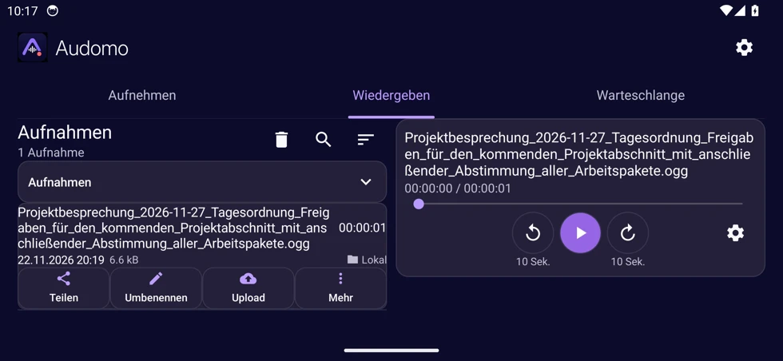
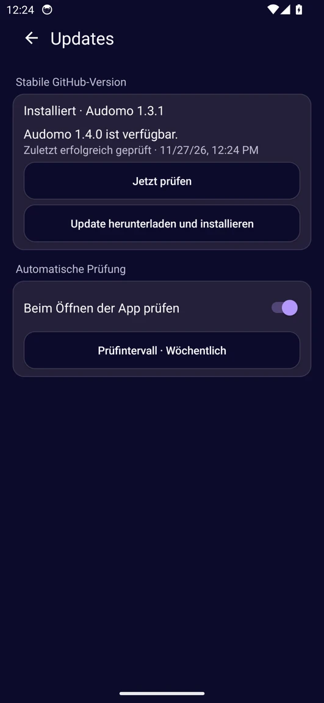

#  Audomo

Audomo nimmt eure Projektbesprechungen auf und benennt die Audiodatei nach dem passenden Termin im Android-Kalender. So findet ihr auch Wochen später die Planungsrunde wieder, in der ihr eine Materialwahl oder einen Liefertermin vereinbart habt.

[Audomo für Android herunterladen](https://github.com/adriantagonist87/Audomo/releases/latest) · Ab Android 14 · [Handbuch](docs/BEDIENUNG.md)

## Besprechungen nur im gemeinsamen Einverständnis aufnehmen

> [!IMPORTANT]
> Audomo wurde ausschließlich für Besprechungen entwickelt, die alle Beteiligten gemeinsam aufzeichnen möchten. Fragt vor dem Start jede Person, ob sie mit der Aufnahme einverstanden ist. Klärt auch, wer sie später anhören darf und ob sie in eure Projektcloud geladen werden soll. Kommt jemand dazu, pausiert die Aufnahme und fragt nach.
>
> In Deutschland macht sich strafbar, wer unbefugt aufnimmt, was eine andere Person in einer nichtöffentlichen Besprechung sagt. Auch wer eine so entstandene Aufnahme unbefugt nutzt oder Dritten zugänglich macht, kann sich strafbar machen. Dafür sieht das Gesetz eine Geldstrafe oder bis zu drei Jahre Freiheitsstrafe vor. [§ 201 Abs. 1 StGB – Verletzung der Vertraulichkeit des Wortes](https://www.gesetze-im-internet.de/stgb/__201.html)

## Vom Kalendertermin zur Aufnahme

Im Kalender „Werkstattumbau“ steht um zehn Uhr die „Planungsrunde“. Ist dieser Kalender in Audomo ausgewählt, erscheint die laufende Besprechung schon beim Öffnen der App. Mit der Dateinamenvorlage „Termintitel“ steht dort bereits `Planungsrunde.ogg`. Ein Tipp auf den grünen Aufnahmeknopf genügt. Soll ein anderer Termin den Namen liefern, tippt auf „Aktueller Kalendertermin“ und wählt ihn in der Tagesansicht aus.

Unter „Einstellungen“ → „Kalender und Dateinamen“ → „Dateiname und Ordner“ könnt ihr Datum, Uhrzeit, Kalender und Termintitel kombinieren. Mit „Unterordner je Kalender“ landet das Gespräch in `Werkstattumbau/Planungsrunde.ogg`. Audomo legt den Ordner bei der ersten Aufnahme an. Die Vorschau zeigt auch, was ohne Termin passiert. Bei der Vorlage `{kalender}_{termin}` heißt die Datei dann `-_Aufnahme.ogg`. Der Bindestrich steht für den fehlenden Kalendernamen.

  
  

## Aufnahme vom Startbildschirm

Unter „Einstellungen“ → „Schnellzugriff und Vibration“ könnt ihr Audomo als Kachel in die Android-Schnelleinstellungen aufnehmen oder das Symbol „Aufnahme“ auf den Startbildschirm legen. Ein Tipp startet die Aufnahme, der nächste beendet und speichert sie. Android zeigt währenddessen die Aufnahmebenachrichtigung an. Ein langer Druck auf die Kachel öffnet Audomo. Im selben Menü könnt ihr die Vibrationsmuster ausprobieren.

Unter „Einstellungen“ → „App-Sperre“ könnt ihr den Zugriff auf Audomo schützen. Beim Öffnen der App fragt Android nach eurem Fingerabdruck oder der eingerichteten Displaysperre (PIN, Muster oder Passwort). Über Kachel und Startbildschirm-Symbol könnt ihr weiterhin aufnehmen, während die Bibliothek gesperrt bleibt.

Wenn ihr für den großen Besprechungsraum andere Klangwerte braucht, speichert sie unter „Aufnahmeprofile“ als eigenes Profil. Dort könnt ihr es später umbenennen oder löschen. Unter „Berechtigungen“ findet ihr auch den Nicht-stören-Zugriff und die Ausnahme von der Akkuoptimierung für längere Aufnahmen. [Aufnahmeprofile im Bild](qa/api34/aufnahmeprofile-1.1.4.webp)

## Besprechungen noch einmal anhören

Wischt von „Aufnehmen“ nach links zu „Wiedergeben“ und tippt auf eine Aufnahme. Lange Dateinamen stehen vollständig über mehrere Zeilen. Im Querformat ist auf breiten Displays neben der Liste Platz für den Player. Über sein Zahnrad könnt ihr das Tempo ändern, die Länge der Sprünge festlegen und „Stille überspringen“ einschalten. Der Player merkt sich die Auswahl. Android-Zurück schließt zuerst den Player und führt danach zur zuletzt besuchten Ansicht.

Vor der Wiedergabe über den Handylautsprecher fragt Audomo nach. Wollt ihr ausschließlich über Bluetooth hören, wählt unter „Einstellungen“ → „Wiedergabe“ → „Audioausgang“ die Option „Nur Bluetooth“. Bricht die Verbindung während der Wiedergabe ab, pausiert der Player.

## Aufnahmen in die Projektcloud laden

Audomo speichert die Aufnahme zuerst auf dem Telefon. Unter „Einstellungen“ → „Cloud und Uploads“ → „Uploadziele“ verbindet ihr Dropbox oder einen Server über WebDAV, SFTP, FTPS oder FTP. Soll Audomo nach der Besprechung automatisch hochladen, wählt ein Standardziel und schaltet den automatischen Upload ein. Die Wartezeit lässt sich in Minuten angeben. Bei `0,5` wartet Audomo mindestens 30 Sekunden. Schiebt ihr eine Testaufnahme in dieser Zeit in den Papierkorb, verschwinden auch ihre offenen Uploadaufträge.

- Vorhandene Aufnahmen hochladen. Drückt unter „Wiedergeben“ lange auf eine Aufnahme, markiert bei Bedarf weitere und tippt auf „Cloud Upload“. Ihr könnt mehrere Ziele auswählen. Für jedes Ziel erscheint ein eigener Auftrag in der Warteschlange.
- Einen Upload vorziehen oder wiederholen. Wischt einen wartenden Auftrag nach rechts, um ihn an die Spitze zu setzen. Nach links entfernt ihr ihn. Tippt auf einen fehlgeschlagenen Auftrag, um die Ursache zu sehen und ihn erneut zu versuchen. Über die Mehrfachauswahl könnt ihr mehrere Aufträge bearbeiten. Die Warteschlange merkt sich euren Filter. „Offene Aufträge“ zählt nur, was noch zu erledigen ist. [Warteschlange im Bild](qa/api34/warteschlange-pruefen-1.1.7.webp)
- Namen und Speicherorte ändern. Haltet eine Aufnahme in „Wiedergeben“ gedrückt und wählt „Umbenennen“. Ihr entscheidet, ob der neue Name auf dem Telefon, für einzelne Cloudkopien oder überall gelten soll. Habt ihr außerhalb von Audomo einen Ordner verschoben, könnt ihr unter „Dateien und Ordner“ → „Ordner verwalten“ die Pfade abgleichen.
- Platz auf dem Gerät schaffen. Der Papierkorb liegt in der Wiedergabeliste neben der Lupe. Löscht ihr nur die lokale Aufnahme, bleibt eine bestätigte Cloudkopie in der Bibliothek auffindbar. Über „Speicherorte“ → „Lokal wiederherstellen“ holt ihr sie zurück. Unter „Einstellungen“ → „Papierkorb“ könnt ihr die Bereinigung nach 30 Tagen einschalten.

Für einen ganzen Dropbox-Ordner gibt es unter „Cloud und Uploads“ die Aktion „Aus Dropbox wiederherstellen“. Sie lädt die Aufnahmen samt Unterordnern aufs Telefon und erkennt bereits vorhandene, identische Dateien. `Dropbox/` steht für den App-Ordner, `Dropbox/Projekte` für einen von euch gewählten Unterordner. [Dropbox-Wiederherstellung im Handbuch](docs/BEDIENUNG.md#aufnahmen-aus-dropbox-zurückholen)

## Auf ein neues Telefon umziehen

Unter „Einstellungen“ → „Sicherung und Diagnose“ → „Sicherung exportieren“ wählt ihr, was mitkommt. Alle drei Sicherungen werden mit einem eigenen Passwort verschlüsselt. Dieses Passwort braucht ihr beim Import wieder.

| Auswahl | Was auf das neue Telefon kommt |
| --- | --- |
| Alle Einstellungen | Unter anderem Aufnahmeprofile, Kalenderauswahl, Dateinamenvorlagen und Uploadregeln |
| Einstellungen und Cloudverbindungen | Zusätzlich die eingerichteten Ziele und die gespeicherten Zugangsdaten |
| Vollständige Migration | Zusätzlich alle Aufnahmen, Papierkorb, Uploadverlauf, bestätigte Cloudpfade und Diagnoseprotokoll |

Die vollständige Migration braucht Zugriff auf Aufnahmen, die nur noch in der Cloud liegen. Beim Import ersetzt „Bestand ersetzen“ die bisherige Bibliothek auf dem Zielgerät. [Anleitung zum Gerätewechsel](docs/BEDIENUNG.md#sicherung-und-gerätewechsel)

## Updates von GitHub

Ab 1.4.0 zeigt „Einstellungen“ → „Updates“ die installierte Version. „Jetzt prüfen“ vergleicht sie mit dem neuesten stabilen GitHub-Release. Die automatische Prüfung ist anfangs ausgeschaltet. Aktiviert ihr sie, könnt ihr bei jedem Start, täglich, wöchentlich oder monatlich prüfen lassen.

Ist ein Update verfügbar, könnt ihr die APK direkt in Audomo laden. Nach der Prüfung von Datei und Signatur öffnet Audomo den Android-Installer. Dort bestätigt ihr die Aktualisierung. Wer noch eine ältere offizielle Version nutzt, installiert die aktuelle APK einmal über die bestehende App. [Stabiles Release herunterladen](https://github.com/adriantagonist87/Audomo/releases/latest) · [Wechsel von einer Testversion](docs/BEDIENUNG.md#wechsel-von-der-testversion)

So sieht ein verfügbares Update in Audomo aus

