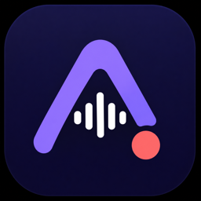
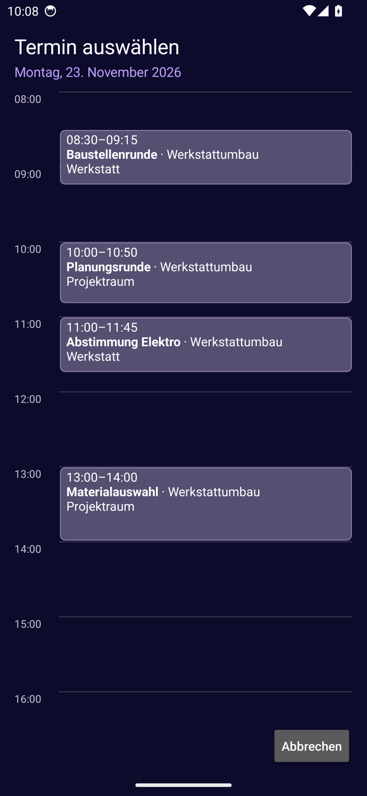
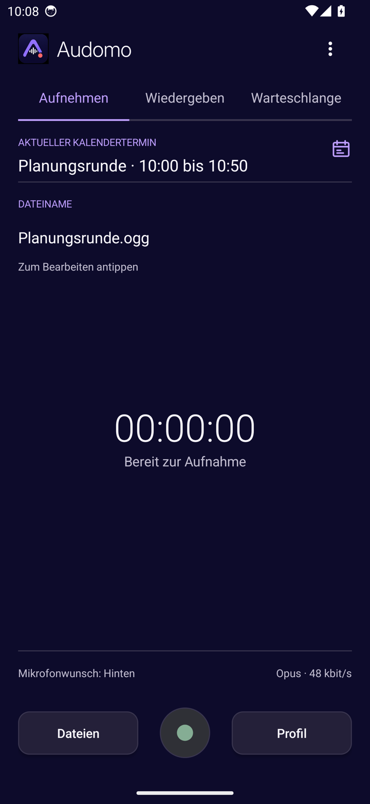
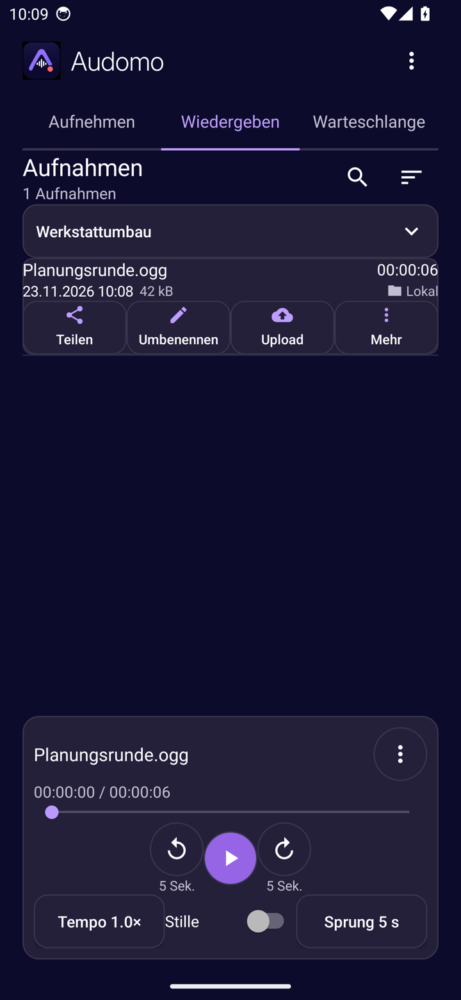

#  Audomo

Audomo nimmt eure Projektbesprechungen auf und benennt die Audiodatei nach dem passenden Termin im Android-Kalender. So findet ihr auch Wochen später die Planungsrunde wieder, in der ihr eine Materialwahl oder einen Liefertermin vereinbart habt.

[Audomo für Android herunterladen](https://github.com/adriantagonist87/Audomo/releases/latest) · Ab Android 14

## Besprechungen nur im gemeinsamen Einverständnis aufnehmen

> [!IMPORTANT]
> Audomo wurde ausschließlich für Besprechungen entwickelt, die alle Beteiligten gemeinsam aufzeichnen möchten. Fragt vor dem Start jede Person, ob sie mit der Aufnahme einverstanden ist. Klärt auch, wer sie später anhören darf und ob sie in eure Projektcloud geladen werden soll. Kommt jemand dazu, pausiert die Aufnahme und fragt nach.
>
> In Deutschland macht sich strafbar, wer unbefugt aufnimmt, was eine andere Person in einer nichtöffentlichen Besprechung sagt. Auch wer eine so entstandene Aufnahme unbefugt nutzt oder Dritten zugänglich macht, kann sich strafbar machen. Dafür sieht das Gesetz eine Geldstrafe oder bis zu drei Jahre Freiheitsstrafe vor. [§ 201 Abs. 1 StGB – Verletzung der Vertraulichkeit des Wortes](https://www.gesetze-im-internet.de/stgb/__201.html)

## Vom Kalendertermin zur Aufnahme

Im Kalender „Werkstattumbau“ steht um zehn Uhr die „Planungsrunde“. Ist dieser Kalender in Audomo ausgewählt, erscheint die laufende Besprechung schon beim Öffnen der App. Mit der Dateinamenvorlage „Termintitel“ steht dort bereits `Planungsrunde.ogg`. Ein Tipp auf den grünen Aufnahmeknopf genügt. Soll ein anderer Termin den Namen liefern, tippt auf „Aktueller Kalendertermin“ und wählt ihn in der Tagesansicht aus.

  
  
  

Wer für jedes Projekt einen Kalender führt, kann denselben Namen auch für den Aufnahmeordner nutzen. Öffnet dazu am Zahnrad „Kalender und Dateinamen“ → „Dateiname und Ordner“ und wählt die Option „Unterordner je Kalender“. Audomo legt den Ordner bei der ersten Aufnahme an. In diesem Beispiel findet ihr das Gespräch anschließend unter `Werkstattumbau/Planungsrunde.ogg`.

## Nach der Besprechung

Unter „Wiedergeben“ könnt ihr eine Passage noch einmal anhören, ein paar Sekunden zurückspringen oder das Abspieltempo ändern. Die Aufnahme wird zunächst auf dem Gerät gespeichert. Wenn ihr einen gemeinsamen Ablageort vereinbart habt, markiert die gewünschten Aufnahmen und wählt „Cloud Upload“. Für regelmäßige Runden lässt sich der Upload auch automatisch starten, auf Wunsch mit einigen Minuten Verzögerung. [Bedienungsanleitung und unterstützte Cloud-Dienste](docs/BEDIENUNG.md)

Die offizielle Version 1.0.0 lässt sich direkt aktualisieren. Wer eine debug-signierte Testfassung nutzt, sollte vor dem Wechsel die Aufnahmen sichern. Die stabile Ausgabe verwendet einen eigenen Signierschlüssel. [Anleitung für den Wechsel](docs/BEDIENUNG.md#wechsel-von-der-testversion)
